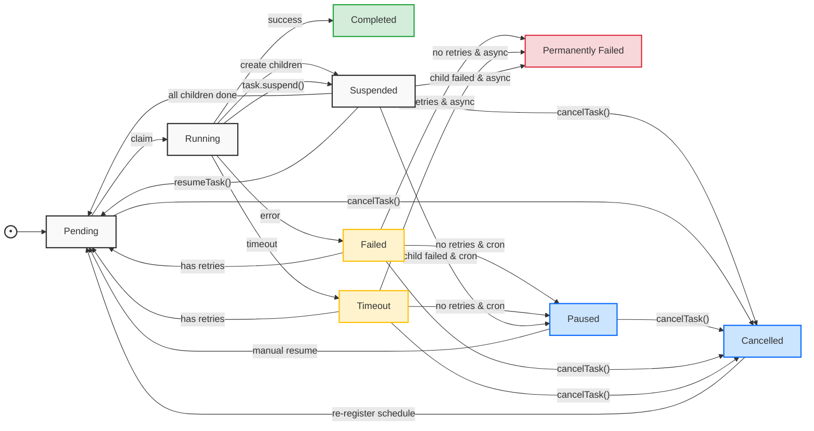

# Core Concepts

This document provides a comprehensive overview of the core concepts in fib-flow, a robust task scheduling and workflow management system. It covers essential topics including task states, state transitions, different types of tasks, and error handling mechanisms. Understanding these concepts is crucial for effectively using and implementing fib-flow in your applications.

## Table of Contents
- [Task States and Transitions](#task-states-and-transitions)
  - [Task States](#task-states)
  - [State Transitions](#state-transitions)
  - [State Diagram](#state-diagram)
- [Task Types](#task-types)
  - [Task Handler Configuration](#task-handler-configuration)
  - [Async Tasks](#async-tasks)
  - [Cron Tasks](#cron-tasks)
- [Error Handling](#error-handling)

## Task States and Transitions

### Task States

Tasks in fib-flow can be in the following states:

- `pending`: Task is waiting to be executed. Tasks start in this state and return to it when retrying.
- `running`: Task is currently being executed. The task manager actively monitors tasks in this state.
- `completed`: Task has completed successfully with no errors or timeout issues.
- `failed`: Task execution failed but may be retried based on retry configuration.
- `timeout`: Task exceeded its configured timeout duration and may be retried.
- `permanently_failed`: Async task that has failed and exceeded retry attempts, requiring manual intervention.
- `paused`: Cron task that has failed and exceeded retry attempts, can be resumed manually.
- `cancelled`: Task (or schedule) explicitly cancelled by an operator. A deliberate outcome, not a failure.
- `suspended`: Task waiting for an external condition, manages task dependencies:
  - Parent task waiting for child tasks to complete (suspend reason `awaiting_subtasks`, auto-resumed by the system).
  - Task explicitly suspended for external interaction such as human approval (custom suspend reason, resumed via `resumeTask`).

### State Transitions

Tasks follow these state transition rules:

1. Initial State
   - All tasks start in `pending` state

2. Basic Transitions
   - `pending` → `running`: Task is claimed for execution
   - `running` → `completed`: Task completes successfully
   - `running` → `failed`: Task throws an error
   - `running` → `timeout`: Task exceeds timeout duration

3. Retry Transitions
   - `failed` → `pending`: Task has remaining retry attempts
   - `timeout` → `pending`: Task has remaining retry attempts
   - `failed` → `permanently_failed`: Async task with no retries left
   - `failed` → `paused`: Cron task with no retries left
   - `timeout` → `permanently_failed`: Async task with no retries left
   - `timeout` → `paused`: Cron task with no retries left

4. Workflow Transitions
   - `running` → `suspended`: Parent task creates child tasks
   - `suspended` → `pending`: All child tasks completed successfully
   - `suspended` → `permanently_failed`: Async parent task when any child fails
   - `suspended` → `paused`: Cron parent task when any child fails

5. Explicit Suspension Transitions (human-in-the-loop)
   - `running` → `suspended`: Handler returns `task.suspend({ reason })` for external interaction (e.g. approval)
   - `suspended` → `pending`: `resumeTask(taskId)` — handler re-runs with an advanced stage
   - `suspended` → `cancelled`: `cancelTask(taskId, { reason })` — approval rejected / request abandoned
   - Explicitly suspended tasks are immune to heartbeat and total timeouts; they never auto-resume.

6. Cancellation Transitions
   - `pending` / `paused` / `failed` / `timeout` / `suspended` → `cancelled`: `cancelTask()` or `cancelCron()`
   - `running` → `cancelled` is **rejected**: the in-flight handler owns the row. Pause first, or wait for completion.
   - `cancelled` is a terminal outcome, not a failure: it never propagates failure to a parent workflow and is excluded from `failed_tasks` in workflow summaries.

6. Recovery Transitions
   - `paused` → `pending`: Manually resume a paused cron task
    - `running` → `pending`: Task ownership is recovered after the owning worker becomes dead or superseded

7. Cron Round Semantics
   - A cron row moves `running` → `pending` at the end of each round, with `next_run_time` recomputed from the persisted `cron_expr` / `cron_tz`.
   - A successful round resets `retry_count` to `0` and clears `error`: the retry budget covers attempts inside one round, not the lifetime of the schedule.
   - Re-registering a schedule (`cron()` with the same `(name, cronKey)`) updates the row in place. A `paused` or `cancelled` row is revived to `pending` with a fresh retry budget.
   - With `catchUp: 'skip'`, a round whose scheduled instant is at least one full period in the past is skipped: the attempt is recorded with outcome `skipped`, `next_run_time` advances, and a `task_cron_missed` event is written. The default `'once'` runs the missed window immediately.

Recovery notes:
- `running -> pending` caused by worker recovery is not treated as a normal retry-failure transition.
- The interrupted execution round is recorded in task attempts with outcome `interrupted`.
- The audit stream emits `task_recovered` for this recovery path.

### State Diagram



## Task Types

### Task Handler Configuration
Task handlers can be registered in two forms:
- Function Form: Direct handler registration with global defaults
- Object Form: Registration with task-specific configuration options

```javascript
// Function form - uses global defaults
taskManager.use('simpleTask', async (task) => {
    return { result: 'done' };
});

// Object form - with task-specific defaults
taskManager.use('complexTask', {
    handler: async (task) => {
        return { result: 'done' };
    },
    timeout: 120,       // Task-specific timeout
    max_retries: 2,     // Task-specific retry limit
    retry_interval: 30, // Task-specific retry interval
    priority: 5         // Task-specific priority
});
```

### Async Tasks
- One-time execution tasks that run exactly once
- Can be scheduled with delay using milliseconds or Date objects
- Support configurable priority levels
- Move to `permanently_failed` after max retries
- Can specify dependencies on other tasks to create workflows

### Cron Tasks
- Recurring tasks based on cron expression (e.g., "0 * * * *" for hourly)
- Automatically schedule next run after completion
- Can be paused and resumed through API calls
- Support same retry mechanism as async tasks with configurable intervals
- Support task chaining through dependencies for complex schedules

#### Cron execution modes

A cron row is a **schedule**, not a run. How a round executes is chosen by the
manager-level `cronMode` option (the default keeps 8.0.x behaviour, so upgrading
changes nothing until you opt in):

| Mode | What happens each round | Suspension |
|---|---|---|
| `'inline'` (default) | The cron row itself runs the handler, then resets to `pending` with a new `next_run_time`. The round's `result` is written onto the schedule row. | A handler that suspends leaves the row `suspended`; it stops being `pending`, so the schedule stops firing until `resumeTask()`. |
| `'spawn'` | The cron row never runs business code. Each round inserts an independent `async` run row and advances the schedule **in one transaction**. | A suspending run row is just an `async` task: the schedule ticks normally on the next window. |

```javascript
const manager = new TaskManager({
    dbConnection: 'sqlite:jobs.db',
    cronMode: 'spawn'
});

manager.use('refreshCatalog', async (task) => {
    // Runs on its own async row every round.
    return refresh(task.payload);
});

manager.cron('refreshCatalog', '0 * * * *', { scope: 'all' });
```

Properties that hold in `spawn` mode:

- **At most one spawn per window.** Inserting the run row and advancing the
  schedule share a transaction, so a crash in between cannot produce a second run
  on the next tick.
- **One run = one row.** Retries, suspension, audit events and retention all apply
  to the run row, exactly as they do for a manually enqueued task.
- **The schedule row never executes.** A throwing handler cannot affect
  scheduling; the round's outcome is recorded in
  `getCronSchedules()[].last_error` and a `task_cron_spawn_failed` event.
- **The schedule row does not accumulate attempts or claim events.** A spawn round
  is not an execution, so `getTaskAttempts(scheduleId)` stays empty and the audit
  trail keeps at most 20 `task_cron_spawned` / `task_cron_spawn_failed` /
  `task_cron_missed` rows per schedule. This matters: schedule rows are never
  collected by retention, so an uncapped per-round trail would grow forever
  (a one-minute schedule writes half a million rows a year). The spawned run rows
  are the authoritative round history.
- **Rounds do not overlap by default.** Inline mode was mutually exclusive for
  free: its cron row was `running`, so it could not be claimed. Spawn removes
  that, so the cap is explicit — `maxInstances` defaults to `1`. A round that
  would exceed the cap is skipped: `next_run_time` still advances and a
  `task_cron_overlap_skipped` event is recorded, but no run row is created and
  `error` stays untouched (an overlap skip is not a failure). Pass
  `maxInstances: 0` to allow unbounded overlap.
  The count only includes runs **this schedule spawned**: a task you enqueue
  yourself under the same handler name neither blocks the schedule nor writes to
  its `last_error`. Two schedules that share `name` + `tag` and differ only by
  `cron_key` are likewise counted separately.
- **A failing round leaves its reason on the schedule row.** The failure itself
  lands on the run row (`status: 'failed'`), but the reason is mirrored onto the
  schedule's `error`, so `getCronSchedules()[].last_error` does not stay empty
  while every round fails. It is cleared when a run actually **succeeds**, not
  when the next round starts — otherwise a slow handler would leave the signal
  blank for the whole duration of each run. Note that the schedule status stays
  `pending` — it keeps firing — so a consumer deciding "is this schedule healthy?"
  must read `last_error`, not only `status`.
- **Handler concurrency limits do not starve the schedule.** `max_concurrent_tasks`
  gates runs, not the schedule tick.
- **An orphan schedule does not spawn.** If a schedule's handler is no longer
  registered, the round is skipped rather than spawning a run row nobody can
  claim — such a row would never reach a terminal state and never become a
  retention candidate. The schedule row stays `pending` (not cancelled) and
  resumes as soon as a handler is registered again.
- **The payload is copied verbatim.** fib-flow does not reshape it; whatever shape
  your handler expects must already be stored on the schedule row.

`runCronNow(scheduleId, payload?)` spawns one run immediately without moving
`next_run_time`. It works on any schedule status, so a paused or cancelled
schedule is never revived by a manual trigger. `getCronSchedules()` reports the
most recent run id as `last_spawned_task_id` (derived from the audit trail, not a
column) so callers can track the spawned run.

## Error Handling

1. **Task Timeout**
```javascript
taskManager.use('longTask', async (task) => {
    // Periodically check for timeout
    await step1();
    task.checkTimeout();
    
    await step2();
    task.checkTimeout();
    
    return result;
});
```

2. **Task Retry**
```javascript
// Configure retry behavior
taskManager.async('retryableTask', data, {
    max_retries: 3,        // Maximum 3 total attempts (initial + 2 retries)
    retry_interval: 300
});
```

3. **Error Propagation**
```javascript
taskManager.use('errorTask', async (task) => {
    try {
        await riskyOperation();
    } catch (error) {
        // Task will automatically be retried or marked as failed
        throw new Error('Operation failed: ' + error.message);
    }
});
```

## Audit Snapshot vs History

fib-flow keeps two related but different views of task execution:

- The task table stores the latest snapshot used by the scheduler and lightweight status queries.
- The audit event table and attempt table store the execution history used for replay and diagnosis.

Fields such as `current_stage_name`, `progress_text`, `progress_percent`, `last_event_time`, and `last_event_type` are cache-like snapshot fields for platform display. They are not the authoritative audit history.

If you need to answer questions such as "what happened", "which worker ran this attempt", or "why did this workflow stop", use task events and attempts instead of inferring history from the latest task row.
